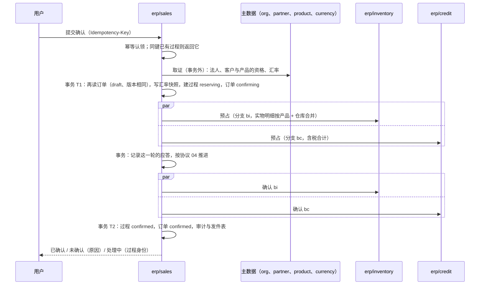

# 订单确认在销售内部怎样落地

协议 04 规定了确认过程的状态、转换与恢复；本页写销售怎样实现它：取证、过程记录、同步路径、恢复工作项、取消与完成时怎样释放分支。状态与转换表本身照协议 04，这里不重复；测试按协议 04 的 RS 编号命名。

## 步骤

| 步骤 | 做什么 | 失败时 |
| --- | --- | --- |
| 幂等认领 | `Idempotency-Key` 认领（SDK 的 `idem`）；同键同请求返回同一过程的当前结果（RS08） | 同键不同请求：冲突 |
| 取证 | 法人 `active`；客户资格 `eligible`；每个产品资格 `eligible`，且明细种类与回答的“是否参与库存”一致；外币订单取 `spot` 有效汇率（订单的业务日期） | 不合格：未确认，原因写明哪一项；依赖不可用：答“依赖不可用”，不建过程 |
| T1 | 锁订单行；仍是 `draft` 且版本与取证时相同（否则重来）；写汇率快照；分支身份（`ids` 生成）写进过程；订单进入 `confirming`（确认中不能修改，RS09）；取证时刻距今超过 W 则不提交、重新取证 | — |
| 预占与确认 | 按轮推进：每一轮向需要的分支并行发同一个命令（带分支身份）；这一轮的应答在一个事务里记到过程上，在过程行的锁下按协议 04 的转换表决定下一状态。有的分支已答、有的未知时，已知的先记下，下一轮只对未知的重发；一轮下来什么都没变才停下 | 结果未知：按分支身份查询；查询也失败时留给恢复工作项 |
| T2 | 过程 `confirmed`、订单 `confirmed`、审计、发件表（订单状态、确认完成）在一个事务（RS06：恢复时从这里继续，不重复确认） | — |

库存分支的明细：实物明细按（产品，仓库）合并，数量是基本单位。信用分支的金额：订单的含税合计，订单币种。

## 同步路径与恢复

- 同步路径的预算是 3 秒（受请求总期限约束）。预算内到达 `confirmed` 或 `rejected` 就直接回答；用完或有未知，回答“处理中”与过程身份（RS07）。
- **恢复工作项**（协议 01 的 `idempotent_external`，每个非终态过程一个，按过程身份去重）：读过程，按每个分支记录的最后状态重发同一个命令（预占、确认、取消都按分支身份幂等），推进到终态。同步路径与恢复工作项调用的是同一个函数（`advance`），不是两套逻辑。
- 恢复工作项在 T1 里与过程一起排入，不带延迟；过程还在同步预算之内时，工作项让路（`work.Wait`），留给同步路径。同步路径完成时它发现过程已是终态，什么都不做；进程在同步路径中途崩溃，预算过后由它接手。
- 发件表让确认事件在消息系统不可用时照常积压（RS18）。

参与方没有应答时怎样，按发生在哪一步：

| 情形 | 用户看到 | 之后 |
| --- | --- | --- |
| 取证时主数据不可达 | 依赖不可用；没有过程，订单仍是 `draft` | 用户稍后重试 |
| 预占或确认的调用超时、应答丢失 | 结果未知：预算内查询（按分支身份）得到结果就照常推进；仍未知则回答“处理中”与过程身份，订单停在 `confirming` | 恢复工作项按协议 01 的退避表重发同一命令；参与方恢复后得到 `held`、`rejected` 或 `expired`，按协议 04 推进；暂存期限（5 分钟）过了，分支 `expired`，过程以“处理超时”结束（RS05），用户再提交一次确认 |
| 部署里没有这个参与方的连接（配置错，T1 时还在） | 同“结果未知” | 每次发送都按未知处理，直到恢复工作项进入死信，过程以“依赖不可用”释放其余分支 |
| 参与方长期不恢复 | 订单一直“确认中”，可以取消 | 恢复工作项用完重试次数（`max_attempts`）进入死信并告警（协议 01）；死信处理把过程转 `rejecting`，释放其余分支，原因“依赖不可用”。取消同样要发到不可达的参与方，同样等它恢复（墓碑保证迟到的预占被拒） |

## 取消

| 订单状态 | 取消做什么 |
| --- | --- |
| `draft` | 本地 `cancelled` |
| `confirming` | 过程转 `cancelling`，对全部参与方发取消（分支不在的留下墓碑，迟到的预占被拒，RS04）；全部完成后订单 `cancelled` |
| `confirmed`，没有交货 | 一个取消过程：对全部分支发取消，完成后订单 `cancelled`；用同一个过程表与恢复工作项 |
| `confirmed`，已有交货 | 拒绝（`STATE_CONFLICT`）：已消耗的部分走退货；关闭未交货部分以后提供（RS13） |

## 完成时释放

订单的全部明细交完并全部出账（`billed` 等于订单的数量与金额）时，在同一个事务里把订单标为 `completed` 并排入释放工作项：对仍有剩余的分支发取消（库存分支通常已被交货消耗完；信用分支本版不被消耗，见信用组件的实现状态）。参与方不自行释放已确认的占用（RS10）。
