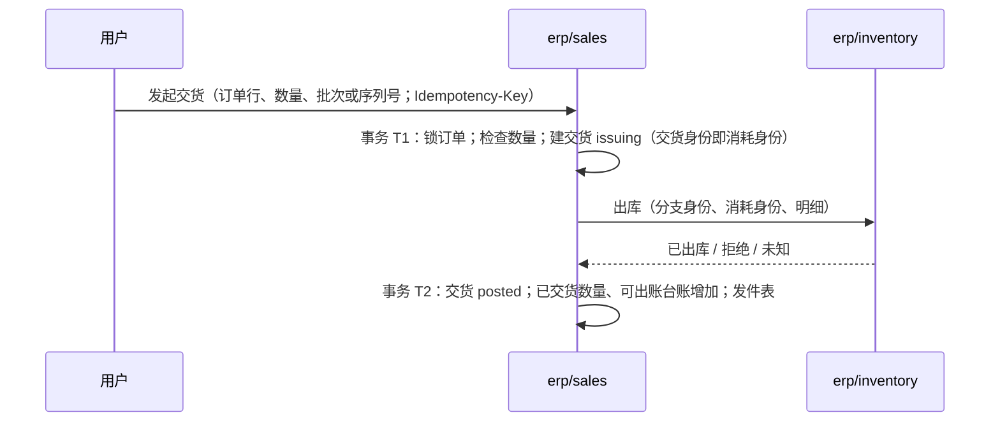

# 交货与可出账台账

本页写销售怎样发起交货、怎样把交货变成可出账额度、怎样回答出账组件的认领。认领的状态与守卫照协议 05 的认领模式（这里不重复），本组件是“出账”用法里额度的属主；测试按协议 05 的 BL 编号命名。

## 交货

| 步骤 | 规则 |
| --- | --- |
| T1 的检查 | 订单 `confirmed`；只含实物明细；每行 `本次数量 ≤ 订单数量 − 已交货 − 交货中（issuing 的交货）`；仓库取明细上的仓库 |
| 出库 | 带库存分支身份与消耗身份（等于交货身份），按消耗身份幂等；批次与序列号的规则由库存裁决（序列号产品必须指定序列号） |
| 已出库 | T2：交货 `posted`；明细的已交货数量增加；可出账台账两维的 `billable` 增加（金额算法见 [pricing.md](../rules/pricing.md)）；发件表写“交货已过账”与“来源额度变化” |
| 拒绝 | 交货 `failed`，附库存的原因；不改任何数量 |
| 未知 | 交货留在 `issuing`；恢复工作项用同一消耗身份重发出库（幂等），直到已出库或拒绝 |

服务明细不交货。本版服务明细在订单确认的事务里 `billable` 直接等于订单的数量与金额（服务完成的登记以后提供）。

## 可出账台账

每个订单行一行，两维（数量、金额）各有 `billable`、`claimed`、`billed`。不变量：每一维 `claimed + billed ≤ billable`。改它的只有三处：交货过账（`billable` 增加）、确认服务订单（`billable` 设定）、认领命令（下表）。来源减少（订单修订、关闭）本版不做，所以 BL03 的拒绝随修订一起实现。

## 出账认领

出账组件按草稿账单认领一张订单的若干行，一次认领一个身份、覆盖多行；所有命令锁订单行（同一订单的认领串行），按认领身份幂等。

| 命令 | 本组件做什么 |
| --- | --- |
| 认领 | 每行每维检查 `claimed + billed + 数量 ≤ billable`，全部满足才建认领 `pending`（期限 7 天）并增加 `claimed`，否则整体拒绝（BL01）；同身份同内容返回原认领（BL02），不同内容冲突 |
| 续期 | 只对 `pending`；延长期限 |
| 确认 | `pending` → `confirmed`；已到期则拒绝（BL05、BL26）；重复确认返回同一结果（BL24） |
| 正式化 | 只对 `confirmed`；每行按实际数量（≤ 认领）：`claimed` 减认领数、`billed` 加实际数；同数量重复无害 |
| 释放 | `pending` 或 `confirmed` → `released`，`claimed` 减回；`confirmed` 的只接受出账组件发来的释放 |
| 到期（工作项） | `pending` 且过期限 → `expired`，`claimed` 减回；与确认在同一订单行锁下裁决，已确认的不到期 |
| 冲回 | 以后（更正，BL06、BL70） |

认领正式化后，如果订单的全部明细交完并全部出账，同一个事务把订单标为 `completed` 并排入释放剩余分支的工作项（[confirmation.md](confirmation.md#完成时释放)）。
